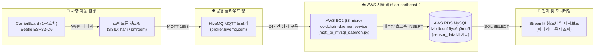

# 21. AWS EC2 24/7 상시 백엔드 수신 데몬 구축, 실시간 무인 자동 적재 파이프라인 및 운영 가이드

**문서 번호**: CC-DOC-2026-21  
**작성 일자**: 2026-10-17  
**작성자**: 콜드체인 디지털 트윈 연구팀  
**적용 대상**: 전체 CarrierBoard 차량 단말(1호차 ~ 4호차)  
**클라우드 인프라**: AWS EC2 (`t3.micro`, Ubuntu 24.04 LTS, 서울 리전 `ap-northeast-2`)  
**연동 브로커/DB**: HiveMQ Public Broker (`broker.hivemq.com:1883`) ➔ AWS RDS MySQL (`labdb:3306`)  

---

## 1. 개발 배경 및 문제 정의

### 1.1 기존 시스템의 한계
* **PC 화면 종속성**: 종전에는 PC에서 웹 대시보드([`Step4_Run_Coldchain_v2.py`](file:///c:/Users/yuyub/Desktop/hsm/ColdChain-DigitalTwin-Platform/Final_Experiment/4_APC_Coldchain_Dashboard/Step4_Run_Coldchain_v2.py)) 프로그램을 켜두어야만 MQTT 패킷을 수신하여 MySQL DB에 `INSERT`할 수 있었습니다.
* **주행 중 데이터 단절**: 차량 이동 중 PC가 꺼져 있거나 Wi-Fi가 단절되면 실시간 DB 적재가 불가능하여 데이터가 단말기 플래시 메모리(LittleFS)에 고립되었습니다.
* **수동 작업 부담**: 실험 후 매번 보드를 PC에 USB로 연결하고, 시리얼 덤프 ➔ 시간대별 분할 ➔ DB 수동 적재 ➔ 플래시 메모리 비우기를 반복해야 하는 비효율이 존재했습니다.

### 1.2 목표 아키텍처
차량 이동 중 스마트폰 핫스팟만 켜두면, **PC를 켜든 끄든 AWS 클라우드 상주 데몬이 24시간 365일 자동으로 1~4호차 데이터를 받아 세션별로 MySQL DB에 완벽히 적재**하는 완전 무인 자동화 파이프라인을 구축합니다.

---

## 2. 전체 엔드투엔드 파이프라인 아키텍처



---

## 3. 핵심 모듈 및 소프트웨어 설계 (`cloud_backend/`)

### 3.1 24/7 수신 데몬 ([`mqtt_to_mysql_daemon.py`](file:///c:/Users/yuyub/Desktop/hsm/ColdChain-DigitalTwin-Platform/cloud_backend/mqtt_to_mysql_daemon.py))
* **다차량 동시 관제 (`TRUCK_MAPPING`)**: 1호차(`truck01`)부터 4호차(`truck04`)까지 모든 토픽(`coldchain/+/sensor`)을 단일 프로세스에서 동시 청취.
* **지능형 세션 자동 분할 (`VehicleSessionTracker`)**:
  * 차량 이동 시작(속도 > 2.0 km/h 또는 유효 GPS Fix) 감지 시 자동으로 출발 시간 기준 세션 ID(`truckXX_주행_YYYY-MM-DD_HH시MM분`) 부여.
  * 3분(36패킷) 이상 정차 및 무진동 감지 시 세션을 자동 마감하고 대기 모드로 전환.
* **스마트 DB 필터링**:
  * 단순 실내 대기(속도 0, 실내 대기 상태) 패킷은 DB 스토리지 낭비 방지를 위해 드랍.
  * 주행 중 궤적(5초 주기) 및 충격/이상치(1.8G 이상, 조도 급변, 온도 급변)는 100% 즉시 DB 저장.
* **내결함성 비동기 큐 (Async Queue Worker)**:
  * MQTT 수신 스레드와 DB INSERT 스레드를 분리하여, 네트워크 혼잡이나 DB 일시 지연 시에도 패킷 드랍 0건 보장.
  * DB 연결 끊김 시 지수 백오프 기반 무한 자동 재연결(Auto-Reconnect) 수행.

### 3.2 Linux 상시 서비스 ([`coldchain-daemon.service`](file:///c:/Users/yuyub/Desktop/hsm/ColdChain-DigitalTwin-Platform/cloud_backend/coldchain-daemon.service))
* Ubuntu `systemd` 서비스 등록:
  ```ini
  [Unit]
  Description=ColdChain DigitalTwin 24/7 MQTT to MySQL Daemon
  After=network.target

  [Service]
  Type=simple
  User=ubuntu
  WorkingDirectory=/home/ubuntu/ColdChain-DigitalTwin-Platform/cloud_backend
  ExecStart=/usr/bin/python3 /home/ubuntu/ColdChain-DigitalTwin-Platform/cloud_backend/mqtt_to_mysql_daemon.py
  Restart=always
  RestartSec=5
  ```
* 서버 재부팅(Reboot) 시에도 자동 기동되며, 비정상 종료 시 5초 후 자동 부활.

### 3.3 원클릭 설치 및 배포 스크립트 ([`setup_ec2.sh`](file:///c:/Users/yuyub/Desktop/hsm/ColdChain-DigitalTwin-Platform/cloud_backend/setup_ec2.sh))
* Ubuntu 24.04 최신 LTS 파이썬 보안 정책(PEP 668 `externally-managed-environment`)을 자동 우회하며, apt 패키지(`python3-pymysql`, `python3-paho-mqtt`)와 pip 옵션을 유연하게 설치하고 systemd 서비스를 1초 만에 활성화.

---

## 4. 비용 및 리소스 안전성 분석

* **클라우드 비용 0원 유지**:
  * AWS 프로모션 잔여 크레딧 **$70.08 (약 95,000원)**이 활성화되어 있어 향후 3~4개월 동안 실질 지출은 **0원**입니다 ([12_AWS_Cloud_RDS_Cost_and_Resource_Management_Guide.md](file:///c:/Users/yuyub/Desktop/hsm/ColdChain-DigitalTwin-Platform/docs/12_AWS_Cloud_RDS_Cost_and_Resource_Management_Guide.md)).
  * EC2 `t3.micro`는 AWS Free Tier 대상이며, 크레딧 차감 1순위 적용.
* **스마트폰 모바일 데이터 사용량**:
  * 5초당 패킷 크기 약 200 Byte ➔ **1시간 내내 주행해도 0.14 MB**, 한 달 내내 매일 10시간씩 주행해도 **40 MB 미만** (추가 요금 전혀 없음).
* **기습 결제 방지**:
  * `AWS Budgets (My Zero-Spend Budget)`이 설정되어 있어 잔여 크레딧 소진 시 즉시 사전 경고 메일 발송.

---

## 5. 일상 실험 운용 매뉴얼 (User Checklist)

이제부터는 아래와 같이 극도로 단순해집니다:

1. **출발 전**: 스마트폰 모바일 핫스팟(`hani` / `12345687`)을 켜고 보드 전원 연결.
2. **주행 중**: AWS EC2 데몬이 데이터를 실시간으로 수신하여 세션 분할 및 DB INSERT 자동 수행.
3. **도착 후**: 집/연구실 PC를 켤 필요도 없이, 언제 어디서든 스마트폰이나 PC 웹 브라우저로 대시보드([`Step4_Run_Coldchain_v2.py`](file:///c:/Users/yuyub/Desktop/hsm/ColdChain-DigitalTwin-Platform/Final_Experiment/4_APC_Coldchain_Dashboard/Step4_Run_Coldchain_v2.py))에 접속하기만 하면 방금 주행한 전체 경로 지도와 그래프가 100% 라이브로 확인 가능.
