# 24. 콜드체인 공급망 v3 전면 개편 보고서 (16자리 통합 코드 · `A00~D10` 분기 공정 · 농가 QR 스캐너 연동 · FDT 실내 창고 로깅 보강)

**문서 번호**: CC-DOC-2026-24  
**작성 일자**: 2026-11-22  
**작성자**: 콜드체인 디지털 트윈 연구팀  
**적용 대상**: AWS RDS(`lab225` / `lab225_v2`), 실시간 브릿지·데몬, FastAPI 4-in-1 포털, Streamlit 24/7 소비자·관리자 포털, PC GUI/에뮬레이터, ESP32 QR 스캐너(`COM16`), FDT 2호차(`COM17`, `carrier-c6-02`)

---

## 1. 개편 배경 및 핵심 변경 요약

기존 직선형 `A00~A16` 실험 체계를 실제 농산물 산지·APC·유통·판매처 현장의 분기 프로세스와 다품목·다일자 농가 관리 요구에 맞추어 **공급망 v3 체계**로 전면 개편했습니다. (기존 `A00~A16` 실증 데이터는 `Final_Experiment/_backup_before_v3_20261122/`에 백업 및 `protocol_ver='v2'`로 100% 하위 호환 유지)

### 1.1 16자리 통합 로트 코드 (`LotID`) 표준 규격
한 농가가 여러 작물을 서로 다른 수확 일자에 생산할 때 품목·일자별로 완벽히 분리 추적하기 위해 **16자리 고정 길이 `LotID`**를 전체 시스템의 단일 기준 키로 도입했습니다.

$$\text{LotID (16자리)} = \underbrace{\text{AreaCode}}_{5\text{자리}} + \underbrace{\text{FmID}}_{2\text{자리}} + \underbrace{\text{CropCode}}_{3\text{자리 (aT KAMIS)}} + \underbrace{\text{HarvestDate}}_{6\text{자리 (YYMMDD)}}$$

* **예시**: 장수군 번암면(`55632`) + 농가 `07` + 사과(`411`) + 2026-11-22 수확(`261122`) ➔ **`5563207411261122`**
* **aT(한국농수산식품유통공사 KAMIS) 공식 표준 3자리 작물 코드 ([supply_chain_spec.py](../cloud_backend/supply_chain_spec.py))**:
  | 품목 (`FrT`) | 품종 (`Vt`) | 표준 3자리 코드 (`CC`) |
  | :--- | :--- | :---: |
  | 사과 (`Apples`) | Fuji / Hongro / Gamhong Apple | **`411`** |
  | 배 (`Pears`) | Shingo / Wonhwang / Gamcheon Pear | **`412`** |
  | 복숭아 (`Peaches`) | mibaegdo / cheonjungdobaegdo / yumyeongdo | **`413`** |
  | 감귤 (`Tangerines`) | eunju / cheong tangerine / mandarin | **`415`** |
  | 참외 (`Melons`) | `cham-oe` | **`222`** |
  | 멜론 (`Melons`) | `net melon` / `baegja melon` | **`223`** |

---

## 2. 신규 `A00 ~ D10` 분기 공정 흐름 및 QR 스캐너 동작

```mermaid
flowchart LR
    A00["🌱 A00 농가 수확<br/>(포털: 16자리 무색QR)"] --> A01["🏡 A01 농가창고 (선택)<br/>(스캐너 · 온습도)"]
    A00 --> A02["🚜 A02 농가 출하<br/>(스캐너 · 1구간 출발)"]
    A01 --> A02
    A02 -->|"Leg 1 (초록)"| B10["🏢 B10 APC 입고<br/>(스캐너 · 1구간 도착)"]
    B10 --> B12P["❄️ B12 APC창고 선별전 (선택)<br/>(무색QR 스캐너 · 온습도)"]
    B10 --> B11["🔍 B11 APC 선별<br/>(포털: 유색QR A/B/C 변경)"]
    B12P --> B11
    B11 --> B12A["❄️ B12 APC창고 선별후 (선택)<br/>(유색QR 스캐너 · 온습도)"]
    B11 --> B13["🚛 B13 APC 출하<br/>(유색QR 스캐너 · 2구간 출발)"]
    B12A --> B13
    B13 -->|"Leg 2 (파랑)"| C10["🏬 C10 유통 창고 저장<br/>(유색QR 스캐너 · 2구간 도착 · 온습도)"]
    C10 --> C11["🚚 C11 유통 출하<br/>(유색QR 스캐너 · 3구간 출발)"]
    C11 -->|"Leg 3 (보라)"| D10["🏪 D10 판매처 도착<br/>(유색QR 스캐너 · 3구간 도착)"]
```



### 2.1 ESP32 스마트 QR 스캐너 (`Final_Experiment/2_ESP32_Firmware/src/main.cpp`)
* **AUTO 기본 경로**:
  * 무색 QR: `A00 ➔ A01(농가창고) ➔ A02(농가출하) ➔ B10(APC입고) ➔ B12(선별 전 APC창고)`
  * 유색 QR (`A/B/C` 등급별 독립 추적): `B11 ➔ B12(선별 후 APC창고) ➔ B13(APC출하) ➔ C10(유통창고) ➔ C11(유통출하) ➔ D10(판매처도착)`
* **원터치 분기 선택 (스마트폰 웹 리모컨 `/set?mode=...` · 버튼 더블클릭 · `MODE:A02` 특수 QR)**:
  * 농가창고 생략 직행: 스캐너에서 **`A02`** 선택 후 무색 QR 스캔 (`A00 ➔ A02`)
  * 선별 전 APC 창고 생략: `B10` 입고 후 포털에서 바로 **`B11`** 선별 실행
  * 선별 후 APC 창고 생략 직행: 스캐너에서 **`B13`** 선택 후 유색 QR 스캔 (`B11 ➔ B13`)

---

## 3. 하드웨어 및 백엔드 주요 수정 내역

1. **AWS RDS 비파괴 스키마 확장**:
   * 백업 완료: `Final_Experiment/_backup_before_v3_20261122/` (`lab225.qr` 81건 및 `lab225_v2` 전 메타 테이블)
   * `lab225.qr` 추가 컬럼: `LotID` (`idx_qr_lotid`), `CropCode`, `Farm_StD`, `Farm_DD`, `Dist_StD`, `Dist_OP`
   * `lab225_v2.harvest_lots` 추가 컬럼: `farmer_code`, `crop_code`, `protocol_ver` (기존 16건은 `'v2'`로 마킹해 하위 호환 보존)
2. **FDT 캐리어 센서 보드 2호차 (`COM17`, `carrier-c6-02`) 펌웨어 보강 및 플래싱 완료**:
   * 파일: `Hardware_Prototypes/code26/test/src/carrier_board_mqtt.cpp`
   * 창고(`A01`/`B12`/`C10`) 실내 보관 중에도 **30초 주기** 및 온습도/조도 급변 시 LittleFS 블랙박스·오프라인 버퍼에 무손실 저장(`status: "보관 [실내]"`), `mqtt_to_mysql_daemon.py`에서 `STORAGE` 세션으로 DB 적재.
   * `COM17` 플래싱 및 시리얼 실측 검증 완료 (`16.78°C / 37.27% / 252.5 lx / MQTT PASS`).
3. **실시간 브릿지 · 통합 포털 · 소비자 대시보드 · PC 유틸리티 전면 반영**:
   * `cloud_backend/supply_chain_spec.py` (신규 SSOT 모듈)
   * `cloud_backend/db_v2/bridge_sync.py` (v3 `A00~D10` + 3구간 `shipments` + 누락 방어 보완 + `v2` 하위 호환)
   * `cloud_backend/mqtt_to_mysql_daemon.py` (`STORAGE` 실내 보관 30초 DB 적재)
   * `Final_Experiment/5_Unified_FastAPI_Portal/app.py` & `templates/index.html`
   * `Final_Experiment/3_Consumer_Dashboard/Step5_Run_Dashboard.py`
   * `Final_Experiment/pc_qr_scanner.py`, `Step1_Farm_QR_Creator.py`, `Step3_Sorting_QR_Creator.py`

---

## 4. AWS EC2 24/7 서버 반영 명령어 (배포 안내)

GitHub 푸시 완료 후 AWS EC2(`54.180.112.191`) 터미널에서 아래 3줄을 실행하면 24/7 데몬(`coldchain-daemon`)과 통합 포털(`coldchain-portal`)이 즉시 v3로 갱신됩니다:

```bash
cd ~/ColdChain-DigitalTwin-Platform
git pull origin main
sudo systemctl restart coldchain-daemon coldchain-portal
```
