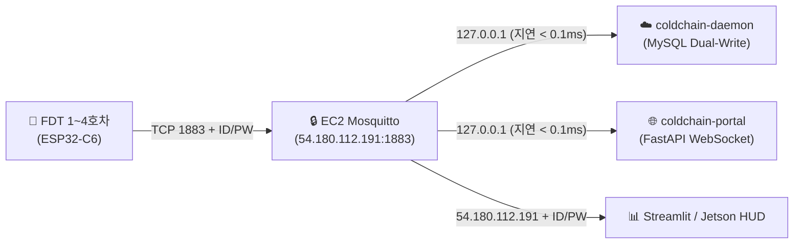

# 25. 콜드체인 MQTT 통신 방식 비교(무료·유료·장단점) 및 AWS EC2 사설 Mosquitto 브로커 전환 계획서

**문서 번호**: CC-DOC-2026-25  
**작성 일자**: 2026-11-22  
**상태**: 📋 **사전 검토·보관 문서 (미적용 — 추후 전환 결정 시 실행용)**  
**적용 예정 대상**: AWS EC2 (`54.180.112.191`, Ubuntu 24.04), `coldchain-daemon`, `coldchain-portal`, Streamlit/Jetson 관제 대시보드, FDT 캐리어 보드(`carrier-c6-01` ~ `04`)

---

## 1. 현재 플랫폼 내 MQTT 역할 요약

* **송신측**: FDT 캐리어 보드 1~4호차 ([carrier_board_mqtt.cpp](../Hardware_Prototypes/code26/test/src/carrier_board_mqtt.cpp)) → 5초 주기 텔레메트리(온도·습도·조도·충격·속도·GPS, 약 200 Byte)를 `broker.hivemq.com:1883` 토픽 `coldchain/truck0X/sensor`로 발행.
* **수신측 (1:N 동시 수신)**:
  1. AWS EC2 상시 데몬 ([mqtt_to_mysql_daemon.py](../cloud_backend/mqtt_to_mysql_daemon.py)) → `lab225.sensor_data` + `lab225_v2` 적재 (주행 5초 / 실내 보관 30초)
  2. AWS EC2 FastAPI 통합 포털 ([app.py](../Final_Experiment/5_Unified_FastAPI_Portal/app.py)) → WebSocket으로 브라우저 관제 탭 실시간 스트리밍
  3. Streamlit 관제 대시보드 / Jetson SplitHUD ([Step4_Run_Coldchain_v2.py](../Final_Experiment/4_APC_Coldchain_Dashboard/Step4_Run_Coldchain_v2.py), [Step4_Jetson_SplitHUD.py](../Final_Experiment/4_APC_Coldchain_Dashboard/Step4_Jetson_SplitHUD.py))
* *(참고: ESP32 QR 스캐너 [main.cpp](../Final_Experiment/2_ESP32_Firmware/src/main.cpp)는 MQTT를 사용하지 않고 AWS RDS MySQL `3306`에 직접 기록)*

---

## 2. 통신 방식별 비용(무료/유료) 및 장단점 종합 비교

> 현재 AWS EC2(`t3.micro`, 서울 리전 `ap-northeast-2`) 및 AWS RDS를 이미 운영 중인 인프라 기준 (2026년 11월 검증 기준).

| 방식 | 비용 (현재 EC2 기준) | 장점 | 단점 / 주의점 |
| :--- | :---: | :--- | :--- |
| **① 현재: 공용 MQTT (`broker.hivemq.com`)** | **추가 비용 \$0** (무료 공용) | • 별도 서버 설정 없이 즉시 동작<br>• 초경량·자동 재연결·1:N 실시간 수신<br>*(참고: HiveMQ Cloud Serverless 무료 티어는 2026-12-31 종료 예정)* | • 인증/보안 없음 (토픽 외부 노출·변조 가능)<br>• 공용 테스트 서버라 SLA/가용성 미보장<br>• 논문/실증 발표 시 외부 공용 브로커 의존 지적 가능 |
| **② EC2 자체 사설 MQTT (`Eclipse Mosquitto`)** *(추천 1순위)* | **추가 비용 \$0** (오픈소스, 기존 EC2 사용) | • **MQTT 장점(초경량·1:N·낮은 배터리 소모·자동복구) 100% 유지**<br>• **ID/PW 인증 + ACL 권한분리 + 선택적 TLS** 적용 가능<br>• 공용 브로커 장애 영향 0%, 코드 수정 최소(주소+ID/PW) | • EC2 초기 설치·포트(1883) 개방 필요(약 15~20분)<br>• EC2 서버 중지·재시작 시 브로커도 함께 재시작(`systemd` 자동복구)<br>• 고정 IP(Elastic IP) 또는 도메인 관리 필요 |
| **③ EC2 FastAPI `HTTP POST` (`/api/telemetry`)** | **추가 비용 \$0** (기존 FastAPI 활용) | • 브로커·데몬 없이 FastAPI 1개로 아키텍처 단순화<br>• 기관/학교 Wi-Fi 방화벽(1883 차단 등) 통과율 우수<br>• API 키 인증 및 응답(`HTTP 200`) 즉시 확인 용이 | • 매 5초 HTTP 헤더·TCP 오버헤드로 트래픽 2~3배·배터리 소모 증가<br>• 전송 지연 시 ESP32 루프 블로킹 방지 튜닝 필요<br>• 1:N 브로드캐스트를 FastAPI가 직접 중계해야 함 |
| **④ EC2 FastAPI `WebSocket`** | **추가 비용 \$0** (FastAPI 내장) | • 연결 후 헤더 오버헤드 작고 초저지연<br>• 양방향 원격 제어(서버→FDT 명령) 유리 | • 이동 중 핫스팟·터널 음영지역에서 반단절(Half-open) 감지 및 재연결 관리가 MQTT보다 까다로움 |
| **⑤ AWS IoT Core (관리형 MQTT)** | **12개월 부분 무료 → 이후 유료** (100만 건당 약 \$1.00, 4대 상시 시 월 \$4~6 수준) | • 상용 최고 수준 보안(기기별 X.509 인증서 + TLS)<br>• 무중단 고가용성·대규모 자동 확장 | • FDT 1대 24시간 5초 전송 ≈ 월 ~104만 건(발행+수신)으로 프리티어(월 50만 건) 초과<br>• 인증서 발급·ESP32 탑재 복잡, RAM/Flash 사용량 증가 |
| **⑥ MySQL 직접 연결 (`3306`)** *(스캐너 방식)* | **추가 비용 \$0** (기존 RDS) | • 중간 수신 서버 불필요, 이벤트성 스캔에 단순·직관적 | • **5초 주기 FDT에는 비추천**: 쿼리 블로킹 시 50Hz 충격 감지 누락 위험, DB 계정 펌웨어 노출, RDS 커넥션 부하 |
| **⑦ MQTT 미사용 (`LittleFS` 오프라인 전용)** | **완전 무료 (\$0)** | • 핫스팟/Wi-Fi 불필요, 배터리 최장 수명 | • 실시간 관제·경보·창고 온습도 자동 연동·실시간 소비자 지도 불가, 실험 후 USB `dump` 수동 업로드 필요 |

---

## 3. [2번 방식] EC2 자체 사설 Mosquitto MQTT 전환 상세 설계 (보관용)

### 3.1 아키텍처 변화



* **EC2 리소스 영향**: 현재 EC2(Ubuntu 24.04, RAM 사용률 39%, 디스크 여유 약 2.0 GB) 기준 Mosquitto는 **RAM 약 3~10 MB, 디스크 2 MB 미만**만 사용.

---

### 3.2 단계별 실행 절차 (추후 적용 결정 시 수행)

#### Step 1. AWS EC2 보안 그룹 인바운드 규칙 추가
* AWS 콘솔 → EC2 → 인스턴스 보안 그룹 → **인바운드 규칙 편집**:
  * 유형: `사용자 지정 TCP` / 포트: **`1883`** / 소스: `0.0.0.0/0` (인증은 Step 2의 ID/PW로 차단)

#### Step 2. EC2(Ubuntu 24.04) Mosquitto 설치 및 인증/권한 설정
```bash
sudo apt update && sudo apt install -y mosquitto mosquitto-clients

# 1) 전용 계정 생성 (예: 센서용 / 대시보드용 분리 가능)
sudo mosquitto_passwd -c /etc/mosquitto/passwd coldchain_sensor
sudo mosquitto_passwd /etc/mosquitto/passwd coldchain_viewer
```

* 설정 파일 `/etc/mosquitto/conf.d/coldchain.conf`:
```text
listener 1883 0.0.0.0
allow_anonymous false
password_file /etc/mosquitto/passwd
acl_file /etc/mosquitto/acl
```

* 권한 분리 파일 `/etc/mosquitto/acl` (선택):
```text
user coldchain_sensor
topic write coldchain/+/sensor

user coldchain_viewer
topic read coldchain/+/sensor
```

* 서비스 활성화 및 동작 테스트:
```bash
sudo systemctl enable --now mosquitto
sudo systemctl status mosquitto

# 로컬 송수신 테스트
mosquitto_sub -h 127.0.0.1 -p 1883 -u coldchain_viewer -P "<PW>" -t "coldchain/+/sensor" -v
```

#### Step 3. 백엔드 · 포털 · 대시보드 환경변수 및 코드 반영 지점
| 파일 | 변경 내용 |
| :--- | :--- |
| [mqtt_to_mysql_daemon.py](../cloud_backend/mqtt_to_mysql_daemon.py) | `MQTT_BROKER` 기본값/환경변수 `127.0.0.1`, `MQTT_USERNAME`/`MQTT_PASSWORD` 지원(`client.username_pw_set`) |
| [app.py](../Final_Experiment/5_Unified_FastAPI_Portal/app.py) | 동일하게 `127.0.0.1:1883` + `username_pw_set` 적용 |
| [Step4_Run_Coldchain_v2.py](../Final_Experiment/4_APC_Coldchain_Dashboard/Step4_Run_Coldchain_v2.py) / [Step4_Jetson_SplitHUD.py](../Final_Experiment/4_APC_Coldchain_Dashboard/Step4_Jetson_SplitHUD.py) | `MQTT_BROKER="54.180.112.191"` (또는 도메인) + Streamlit Secrets/환경변수로 ID/PW 주입 |
| EC2 `systemd` 서비스 파일 | `EnvironmentFile=/etc/coldchain.env`에 `MQTT_BROKER`, `MQTT_USERNAME`, `MQTT_PASSWORD` 보관 (Git 미포함) |

#### Step 4. FDT 센서 보드(1~4호차) 펌웨어 반영 지점
* 파일: [carrier_board_mqtt.cpp](../Hardware_Prototypes/code26/test/src/carrier_board_mqtt.cpp)
  * `mqtt_server`: `"broker.hivemq.com"` → `"54.180.112.191"` *(또는 고정 도메인)*
  * `mqtt_user` / `mqtt_pass`: 별도 헤더(`secrets.h`, `.gitignore` 등록)로 분리
  * 연결 구문 변경:
    ```cpp
    client.connect(clientId.c_str(), mqtt_user, mqtt_pass)
    ```
  * 실전 투입 대상 보드(1~4호차) USB 연결 후 `pio run -e beetle_c6_mqtt_truck0X -t upload` 실행.

---

## 4. 전환 전 체크리스트 및 주의사항

1. **공인 IP 고정 여부 (`54.180.112.191`)**:
   * 일반 퍼블릭 IP는 EC2 `Stop → Start` 시 변경되므로, **AWS Elastic IP 연결** *(이미 퍼블릭 IPv4를 쓰는 실행 중 EC2라면 기존 IPv4 요금과 동일 단가라 추가 비용 없음)* 또는 **무료 DDNS(DuckDNS 등) 도메인** 사용을 권장.
2. **보안 레벨 선택**:
   * **실증·연구 기본안**: `1883` + `ID/PW 인증` + `ACL` (ESP32 메모리 부담 0, 설정 15분).
   * **전송 구간 암호화 확장안**: 도메인 + Let's Encrypt 무료 인증서 + `8883 TLS` + ESP32 `WiFiClientSecure` (RAM 약 30~40 KB 추가 사용).
3. **롤백 방법**:
   * 문제 발생 시 환경변수 `MQTT_BROKER`와 FDT `mqtt_server`를 다시 `broker.hivemq.com`으로 되돌리면 즉시 기존 상태로 원복 가능.
